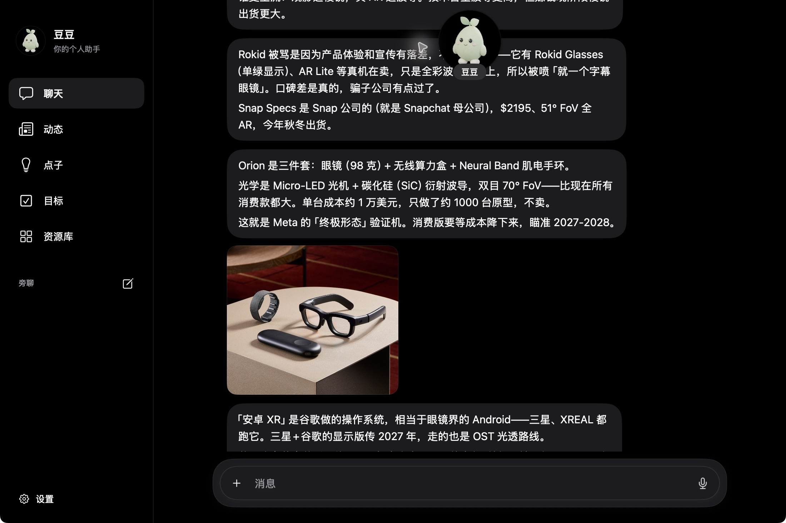
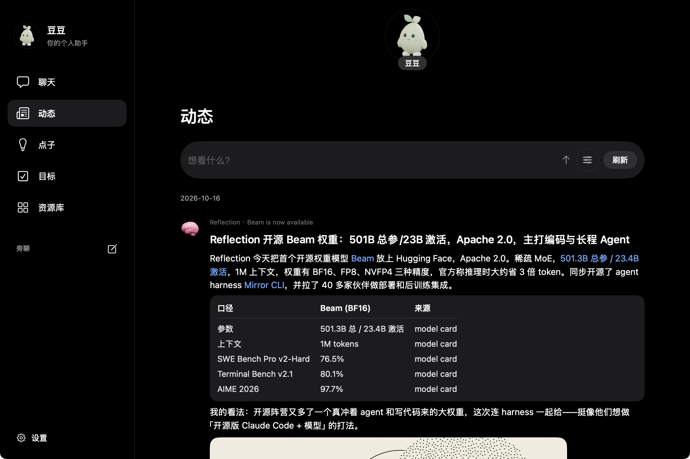
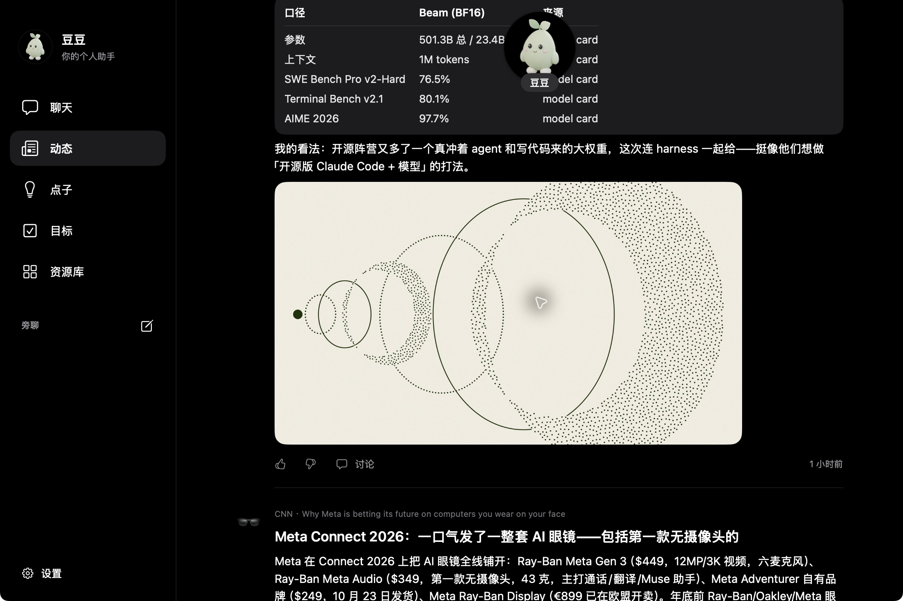
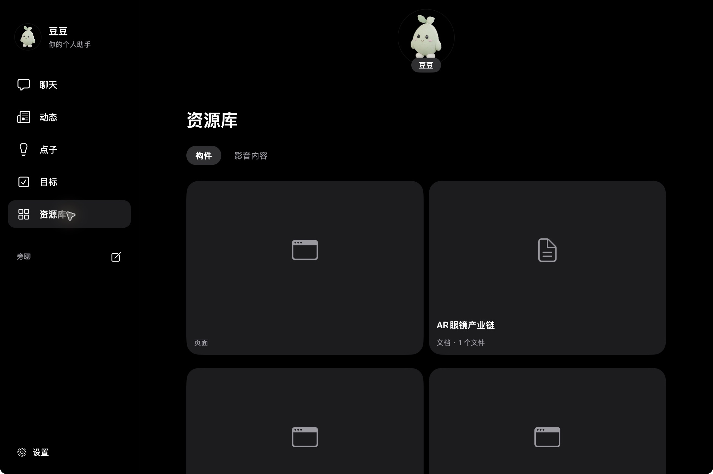
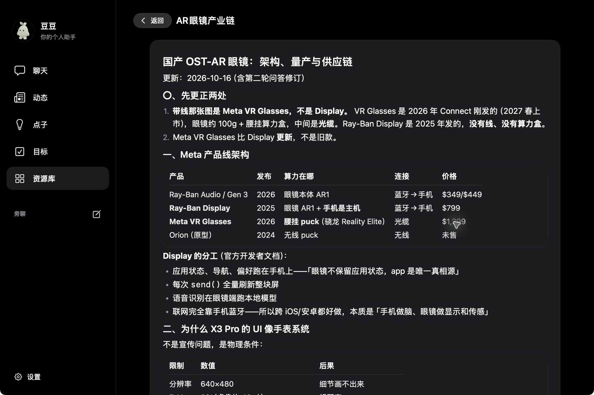
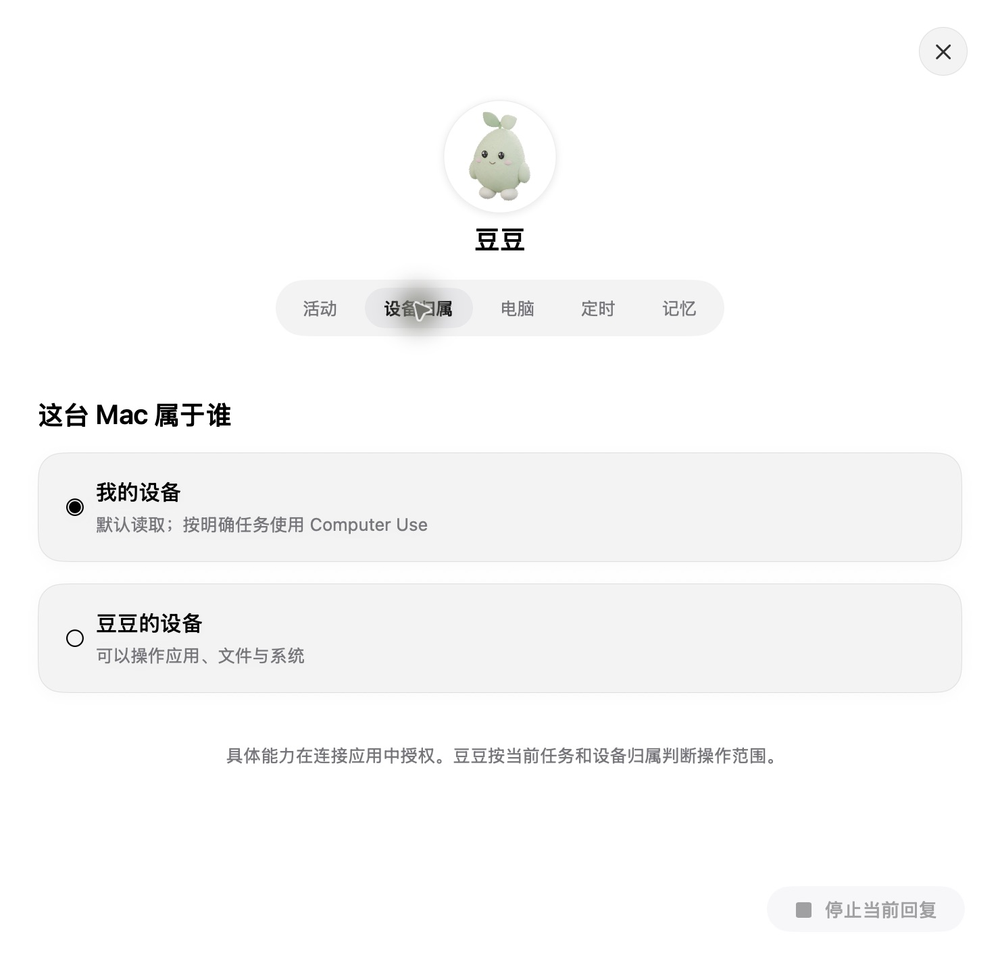
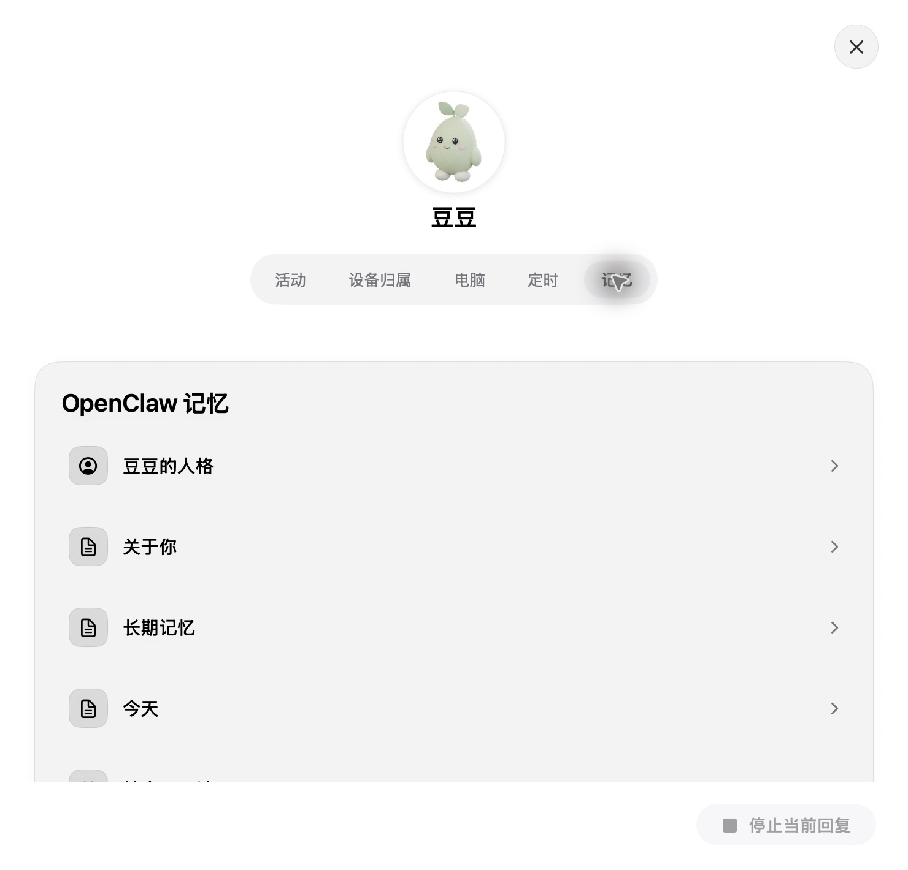
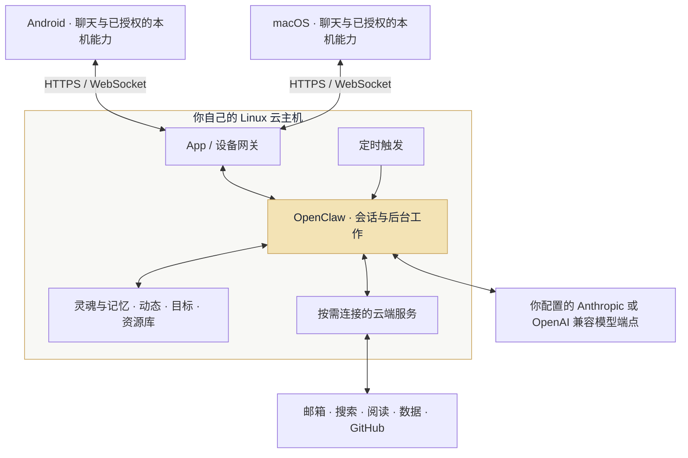
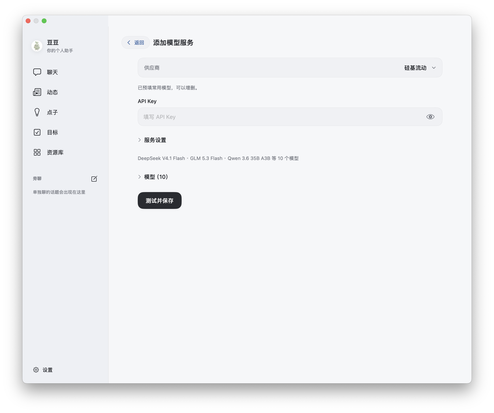

<p align="center"><em>A personal AI companion on your own server.</em></p>

<p align="center">
  
</p>

<p align="center">
  <a href="https://github.com/Xiamu-ssr/personal-agent/releases/tag/v1.3.0"></a>
  
  <a href="https://github.com/openclaw/openclaw"></a>
  <a href="LICENSE"></a>
</p>

<p align="center">
  <a href="#开始使用">下载安装</a> · <a href="#功能">功能与截图</a> · <a href="#架构">架构</a> · <a href="#部署">自部署</a> · <a href="#spec">产品规格</a>
</p>

<p align="center"><strong>从一句话开始，陪你把事情做完。</strong><br>豆豆住在你自己的云主机上，记住你关心的事，到点继续做。<br>手机和 Mac 是同一个助手的两个入口，也是你按需交给它的手脚。</p>

<table width="100%">
  <tr>
    <td width="33%" align="center"><h3>3 端</h3>Android · macOS · 自有云</td>
    <td width="34%" align="center"><h3>5 个栏目</h3>聊天 · 动态 · 点子 · 目标 · 资源库</td>
    <td width="33%" align="center"><h3>13 个连接器</h3>邮箱 · 搜索 · 阅读 · 行情 · 地图 · GitHub</td>
  </tr>
</table>

## 开始使用

**当前版本：[v1.3.0 · OpenClaw](https://github.com/Xiamu-ssr/personal-agent/releases/tag/v1.3.0)。** 需要自己的 Linux 云主机和模型端点；本项目不提供托管账号或内含模型额度。

| 设备 | 安装包 | 要求 |
| --- | --- | --- |
| Android | [下载 APK](https://github.com/Xiamu-ssr/personal-agent/releases/download/v1.3.0/doudou-1.3.0.apk) | Android 9 或更新版本 |
| Mac | [下载 DMG](https://github.com/Xiamu-ssr/personal-agent/releases/download/v1.3.0/doudou-1.3.0.dmg) | macOS 14 或更新版本，Apple 芯片 / Intel 通用 |
| 云端 | [部署指南](docs/deployment.md) | Linux、Node.js 24.16+ 或 26.1+、systemd、Nginx、HTTPS |

先[部署云端](#部署)，生成一次性配对码，再在 App 填入自己的服务器地址。第一次聊天，豆豆会问怎么称呼你、自己叫什么，再推荐需要连接的应用和本机能力。

1.3 重做两端排版与灰蓝配色，缩小头像，减少重复标题和装饰卡片。点子和动态讨论先引用到输入框，可以补话或直接发送；修复活动时间与工具结果解析。Android、Mac 与 cloud 一起升级，已有配对、记忆与原生 Session 保留。 [查看两端界面](docs/images/v1.3.0/README.md)。

**1.0 是不兼容升级，云端与 App 必须一起更新。** 原有配对可继续使用；停服备份并迁移持久化数据，旧聊天与 Session 不导入。Claude Code / Agent SDK 和云端交互浏览器已删除。详见[迁移说明](docs/deployment.md#从-08-升级)。

## 功能

### 想到什么，直接告诉它

发文字、图片、文件，按住说话，或留一条语音笔记。豆豆把回复分成气泡和卡片，图片直接出现在对话里；工具细节收在头像里的控制台，需要时再展开。忙着做事时也能接着说。

下面是作者与豆豆的真实 AR 眼镜讨论，保留实际回答与配图，私人会话名称已遮挡。

<p align="center"><a href="docs/images/v0.8.3/mac-chat.png"></a></p>

### 你关心的事，持续有新消息

告诉它想看什么，它按你的口味找新消息。默认每天 7:00–23:00，每 30 分钟检查一次，每次发布 0–2 条；时间、间隔和偏好都能调整。动态任务使用当前选择的模型，搜索耗时和费用由你配置的服务决定。

来源、正文、表格、原文链接和配图放在同一条动态里。可以赞、踩；点「讨论」把这条动态放进聊天输入框，再补一句自己的问题后发送。

<p align="center"><a href="docs/images/v0.8.3/mac-feed.png"></a></p>

<details>
<summary><strong>展开查看真实动态的配图与讨论入口</strong></summary>

<p align="center"><a href="docs/images/v0.8.3/mac-feed-image.png"></a></p>

</details>

### 单独聊件事，原来的工作接着做

从侧栏或抽屉新开旁聊，围绕另一件事继续问。主聊天和旁聊各自保存消息与选项状态，正在处理的工作不需要停下。头像显示空闲、工作中、等你回复、完成、出错；控制台里的活动可查看任务进度和过程，主聊天的每一句话不会都变成一项活动。

### 点子、目标和成果，各有去处

| 栏目 | 你可以怎么用 |
| --- | --- |
| **点子** | 根据记忆、目标和最近聊过的事，看看豆豆现在能帮上什么忙；点一条先引用到输入框，可以补话或直接发送。 |
| **目标** | 在聊天里定目标，约定跟进频率，持续看进度和下一小步。 |
| **资源库** | 反复打开做好的网页、文档、图片和影音；构件与媒体分别收好。 |

<details>
<summary><strong>展开查看真实资源库与打开的研究文档</strong></summary>

<p align="center">
  <a href="docs/images/v0.8.3/mac-library.png"></a>
  <a href="docs/images/v0.8.3/mac-document.png"></a>
</p>

</details>

### 手机和电脑，按需授权

你的设备提供上下文，豆豆自己的设备负责执行。每台设备分别标记归属；你的设备默认读取，明确任务可使用 Computer Use / Phone Use。

**13 个内置云端连接器**，需要哪个再连接，接入方式见[连接器规格](spec/connectors.md)：

| 用途 | 连接器 | 配置方式 |
| --- | --- | --- |
| 邮件 | QQ、163、126、Gmail、腾讯企业邮、阿里企业邮、通用 IMAP | 只读，支持同服务多个邮箱 |
| 搜索与阅读 | Tavily、微信读书 | 填入各自 API Key |
| 金融信息 | Wind AI、腾讯行情 | Wind 填 Key；腾讯行情免费免 Key，可连接或取消 |
| 地点与出行 | 高德地图 | 填高德 **Web 服务** Key，查地点、距离、路线和天气 |
| 开发协作 | GitHub | 个人访问令牌，连接器只读 |

Tavily、Wind 只在上游明确报告额度耗尽时切换备用账号；网络故障或普通限流不会触发换号。App 显示密钥首尾片段便于区分，模型不会收到完整 Key。高德查询消耗你自己 Key 的配额；不提供下单或打车。

腾讯行情的代码、查询和短缓存都在豆豆内，与股票铃服务隔离，不读取或修改其他项目的配置、账号和数据。

手机可提供已授权的日历、短信、位置、通知与健康数据；Mac 可提供命令行、文件、电脑操作和日历等能力。需要哪项再开启；设备离线时，相应本机能力不可用。

### 同一个豆豆，在更大的屏幕上

手机用悬浮底栏，Mac 用侧边栏，启动图标都使用同一只芽豆。黑白外观跟随系统切换，蓝色留给链接。记忆、活动、设备和定时统一收在头像控制台里。

<p align="center"><sub>上方截图来自 0.8.3 真实账号的 Mac App，私人区域已遮挡。首图由代码排版，将实际截图放入背景与相框；没有 AI 重绘界面。截图中的回答和动态是模型输出，不代表其中事实已逐项核验。<a href="docs/images/v0.8.3/README.md">素材来源与隐私处理</a></sub></p>

1.0 的设备归属与原生记忆页面（隔离测试数据）：

<p align="center">
  
  
</p>

## 架构



**云端是本体，手机和电脑是手脚。** 关掉 App 后，云端定时工作仍能继续；调用本机能力时，那台设备必须在线。网页和应用操作使用在线手机或电脑的能力。

原生记忆保存在 `USER.md`、`MEMORY.md` 和 `memory/`，会话由 `.openclaw/` 管理；内容在 `data/`，草稿在 `workspace/`，连接配置在 `system/`。推理时会将本轮需要的对话、记忆和工具结果发给你配置的模型端点。具体目录和备份方式见[部署指南](docs/deployment.md#数据与维护)。

## 1.0 不兼容升级

已移除 Claude Code / Agent SDK，切换到 OpenClaw 2026.10.4。各端共享一个主 Session，持续 compact；Idea 保留独立栏目，Goal 区分待用户反馈与已完成。记忆采用原生文件和检索，不预设生活分类。

升级前需停服、完整备份并执行一次持久化迁移；旧聊天与 Session 不导入。详见[部署和迁移指南](docs/deployment.md)。

## 部署

准备自己的 **Linux 云主机、Node.js 24.16+ 或 26.1+、Git、curl、OpenSSL、Nginx、systemd 与 HTTPS 域名**，以及兼容 Anthropic Messages 或 OpenAI Chat Completions 的模型端点。

```bash
sudo git clone https://github.com/Xiamu-ssr/personal-agent.git /opt/personal-agent
sudo touch /etc/personal-agent.env
sudo chmod 600 /etc/personal-agent.env
sudoedit /etc/personal-agent.env
```

填写自己的模型端点：

```dotenv
MODEL_BASE_URL=https://api.example.com/anthropic
MODEL_API_KEY=replace-with-your-api-key
AGENT_TZ=Asia/Shanghai
```

在已有 HTTPS 的 Nginx `server` 块中加入：

```nginx
include /etc/nginx/agent-location.inc;
```

安装脚本适用于 **Alibaba Cloud Linux 3 / RHEL 8 的 `dnf` 环境**；其他发行版准备对应依赖后安装 systemd unit。

```bash
cd /opt/personal-agent/cloud
sudo bash deploy/install.sh

# 只检查服务与 HTTPS 路由是否可达
curl --fail https://agent.example.com/agent/health

# 为一台 App 生成一次性六位配对码
sudo -u agent /opt/doudou-runtimes/node-v26.5.0-linux-x64/bin/node /opt/personal-agent/cloud/src/pair.mjs
```

安装脚本会准备 `agent` 用户与 `/srv/agent`，按需生成 `AGENT_TOKEN`，安装本体和 Nginx 路由。它不安装 Node、不申请 HTTPS 证书。

App 填写自己的地址，例如 `https://agent.example.com/agent`，以及配对码。配对码 24 小时有效、用后作废；另一台设备重新生成。配对后发一条消息，确认模型真正回复，再按需连接应用和本机能力。

模型在 App 设置里选择。添加服务时选供应商、填 Key，即可使用预填的接口和模型；内置硅基流动、DeepSeek、智谱、百炼、Kimi、MiniMax、豆包、ZenMux、OpenAI、Anthropic、Gemini、OpenRouter 共 12 家预设。支持修改地址和模型 ID，也可完全自定义。各端共享账号清单与当前模型，切换不新建主 Session。见[模型服务说明](docs/model-providers.md)。

<p align="center"></p>

## Spec

[`spec/`](spec/) 保存产品规格与提示词。聊天行为、动态更新、旁聊、云端与设备的分工，都在这里对齐；其中的草案与待对齐项不等于已发布功能。

直接打开 [`spec/index.html`](spec/index.html)，点架构节点查看产品说明、边界与完整提示词，无需启动服务。

```bash
# macOS，在仓库根目录打开离线规格
open spec/index.html

# 修改规格或提示词后重新生成
node spec/build.mjs
```

规格数据在 [`spec/spec.yaml`](spec/spec.yaml)，提示词在 [`spec/prompts/`](spec/prompts/)。

## 验证与已知限制

1.3 的[验收记录](verification/v1.3.0/result.json)区分隔离界面检查与真实云端：包含签名 APK 在 Android 模拟器连接生产 HTTPS 的活动详情、点子引用与历史恢复，以及 Mac 原生界面操作。原生工具循环与主会话重启续接的实测见 [1.1 发布记录](https://github.com/Xiamu-ssr/personal-agent/releases/tag/v1.1.0)。

- 本版 Android 已构建签名安装包，尚未进行真机验收；健康数据和手机权限仍需要真机验证。
- 手机和电脑的应用操作需要实际设备在线、授权；模型、搜索和第三方服务的费用另计。
- 动态刷新时间受搜索与模型响应影响，不保证在每个检查时点立即生成内容。
- 云端交互浏览器和接管界面已移除。资源库本地 HTML 缩略图使用短时渲染。

## 从源码构建

**Android**：JDK 17、Android SDK 36，最低 Android 9。

```bash
cd android
./gradlew assembleRelease -PenableReleaseSigning=true
# 产物：app/build/outputs/apk/release/app-release.apk
```

自己的签名配置放在 `~/.personal-agent/signing.properties`，并通过上面的参数启用；没有签名配置时，当前脚本使用 debug 签名。

**Mac**：macOS 14+、Xcode Command Line Tools，在仓库根目录运行：

```bash
# 首次构建创建自己的本地签名身份，可能弹出钥匙串授权
bash mac/tools/make-signing-identity.sh
VERSION=1.1.0 bash mac/build.sh
# 产物：mac/build/doudou-1.3.0.dmg；Apple 芯片 + Intel 通用
```

Mac 安装包采用本地签名，未做 Apple 公证；首次安装的打开方式见[发布说明](https://github.com/Xiamu-ssr/personal-agent/releases/tag/v0.8.3)。

## License 与致谢

以 [MIT License](LICENSE) 开源，Copyright © 2026 Xiamu-ssr。第三方依赖与素材遵循各自许可证。

感谢 [OpenClaw](https://github.com/openclaw/openclaw)、[Model Context Protocol](https://github.com/modelcontextprotocol/typescript-sdk)、[Jetpack Compose](https://developer.android.com/compose)、[SwiftUI](https://developer.apple.com/xcode/swiftui/)、[Playwright](https://github.com/microsoft/playwright) 与所有依赖项目。0.8 的会话与动态交互参考了 Meta Muse。

<p align="center"><strong>让你的助手，住在你自己的云里。</strong><br><sub>如果豆豆对你有用，欢迎 Star、反馈和一起改进。</sub></p>
