<p align="center"><em>A self-hosted AI companion, always there — with your phone and Mac as its hands.</em></p>

<p align="center">
  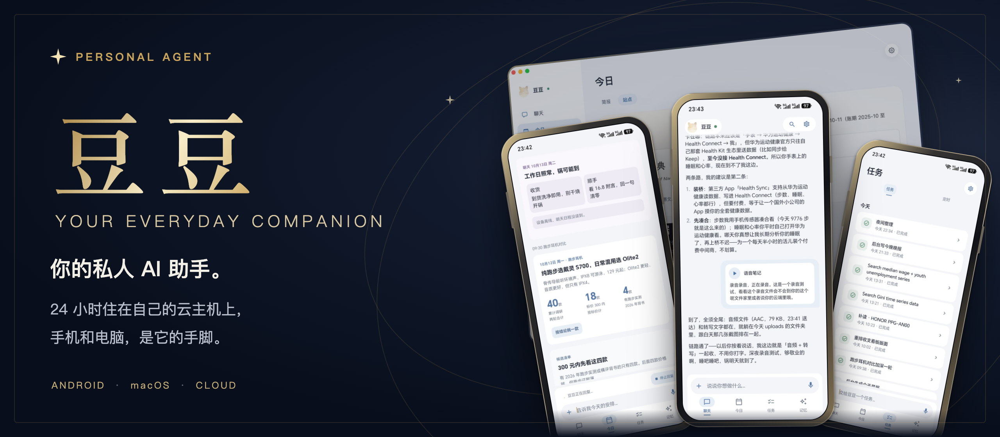
</p>

<p align="center">
  <a href="https://github.com/Xiamu-ssr/personal-agent/releases/latest"></a>
  
  <a href="https://github.com/anthropics/claude-agent-sdk-typescript"></a>
  <a href="LICENSE"></a>
  
</p>

<p align="center">
  <a href="#功能">功能</a> · <a href="#截图">截图</a> · <a href="#架构">架构</a> · <a href="#部署">部署</a> · <a href="#spec">Spec</a>
</p>

<p align="center"><strong>一个像 Today AI 那样的私人 AI 助手。</strong><br>住在你自己的云主机上，记得你说过的事，到点做事，做好了再来告诉你。</p>

<table width="100%">
  <tr>
    <td width="240" align="center"><h3>3 端</h3>云端 · 安卓 · Mac</td>
    <td width="240" align="center"><h3>10 个</h3>内置云端连接器</td>
    <td width="240" align="center"><h3>3 套</h3>银蓝 · 纸墨 · 夜幕</td>
    <td width="240" align="center"><h3>103 项</h3>v0.6.0 云端测试通过</td>
  </tr>
</table>

<p align="center"><sub>连接器数量来自<a href="cloud/connectors/index.mjs">注册表</a>；测试数字来自 <a href="https://github.com/Xiamu-ssr/personal-agent/releases/tag/v0.6.0">v0.6.0 发布记录</a>：云端 103 项、安卓 58 项单元测试 + 7 项模拟器检查，Mac 本地假服务下 27 张截图验收。</sub></p>

## 功能

### 把日常交代给豆豆

云端持续工作，关掉 App 也能做简报、跑任务、整理记忆。需要手机或电脑时，豆豆再调用你已经开启的本机能力。

<table width="100%">
  <tr>
    <td width="330" align="center"><a href="docs/images/phone-chat.jpg">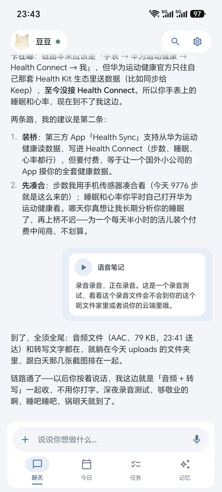</a></td>
    <td width="630" valign="middle">
      <sub>01 / CHAT</sub>
      <h3>想到什么，就说什么。</h3>
      <ul>
        <li>文字、图片、文件、拍照，都能直接发。</li>
        <li>按住说话，或留一条带音频与转写的语音笔记。</li>
        <li>输入框一直可用，忙时消息会排队，还能修改、撤回。</li>
        <li>往上翻历史时，新消息安静等在「回到底部」按钮里。</li>
      </ul>
    </td>
  </tr>
</table>

<table width="100%">
  <tr>
    <td width="630" valign="middle">
      <sub>02 / TODAY</sub>
      <h3>醒来，有一份为你准备的今日。</h3>
      <ul>
        <li>晨报、晚报，把日程、消息和没收尾的事放到眼前。</li>
        <li>一个主题一张 HTML 卡片，按钮能直接接着聊。</li>
        <li>书架、收支看板、宏观数据，做成可以反复打开的站点。</li>
        <li>简报和站点交付前，豆豆会按手机宽度截图检查排版。</li>
      </ul>
    </td>
    <td width="330" align="center"><a href="docs/images/phone-today.jpg">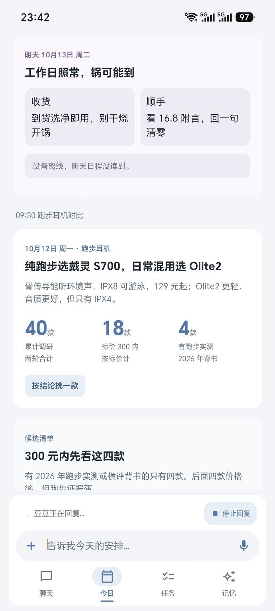</a></td>
  </tr>
</table>

<table width="100%">
  <tr>
    <td width="330" align="center"><a href="docs/images/phone-tasks.jpg">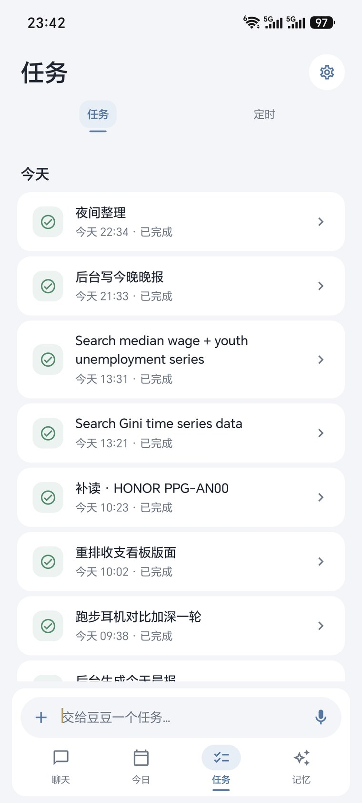</a></td>
    <td width="630" valign="middle">
      <sub>03 / TASKS</sub>
      <h3>它去忙，你继续聊。</h3>
      <ul>
        <li>耗时的工作在后台并行做，主聊天照常可用。</li>
        <li>进度和结果留在任务里，完成后豆豆会告诉你。</li>
        <li>按进行中、今天、近 7 天、更早分组，旧任务也找得到。</li>
        <li>打开任务继续发文字、图片、文件；云端重启后也能接着做。</li>
      </ul>
    </td>
  </tr>
</table>

<table width="100%">
  <tr>
    <td width="630" valign="middle">
      <sub>04 / CONNECTIONS</sub>
      <h3>接上你的生活，也接上你的设备。</h3>
      <ul>
        <li>邮箱、Tavily 搜索、微信读书、Wind AI，在云端连接。</li>
        <li>手机提供日历、短信、位置、通知与健康数据。</li>
        <li>Mac 提供命令行、文件、电脑操作、日历与豆豆浏览器。</li>
        <li>本机能力由你逐项开启；设备离线或数据读不到，会如实说明。</li>
      </ul>
    </td>
    <td width="330" align="center"><a href="docs/images/phone-connectors.jpg">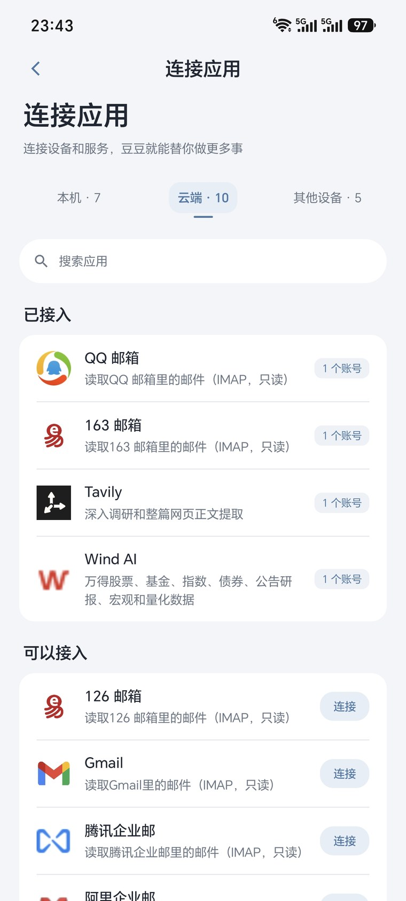</a> <a href="docs/images/phone-devices.jpg">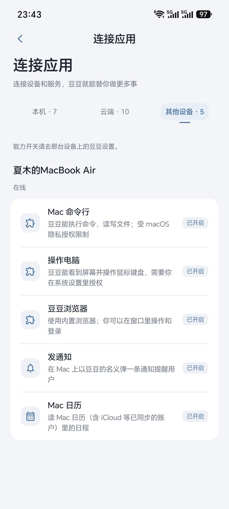</a><br><sub>云端服务 / 其他设备</sub></td>
  </tr>
</table>

<table width="100%">
  <tr>
    <td width="330" align="center"><a href="docs/images/phone-memory.jpg">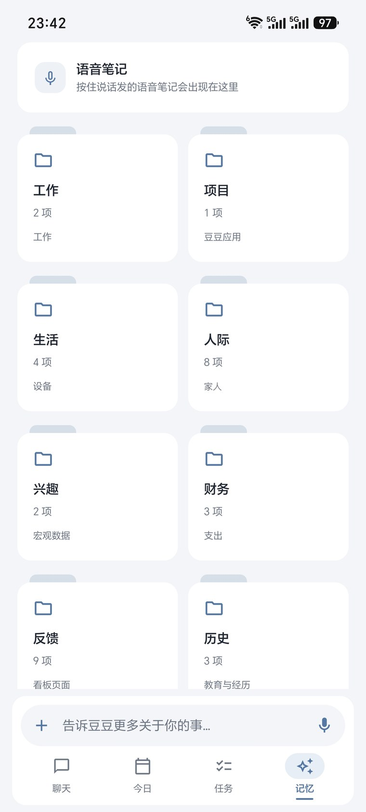</a></td>
    <td width="630" valign="middle">
      <sub>05 / MEMORY</sub>
      <h3>记住事实，慢慢懂你。</h3>
      <ul>
        <li>只记你亲口说的、或从数据里直接看到的事实。</li>
        <li>数据来源写明出处与日期，推断不写进记忆。</li>
        <li>总档串起人物、偏好、生活、项目等主题，随时可以查看。</li>
        <li>事实变了就原地更新，你说「忘掉」就删掉。</li>
      </ul>
    </td>
  </tr>
</table>

<table width="100%">
  <tr>
    <td width="630" valign="middle">
      <sub>06 / HEALTH &amp; APPEARANCE</sub>
      <h3>照顾日常，也照顾你的感受。</h3>
      <ul>
        <li>睡眠、静息心率、心率变异性、步数，配上 7 天趋势。</li>
        <li>手机开启健康能力后，每 3 小时自动同步，也能手动同步。</li>
        <li>周报和健康记录放在一起；没有的数据就显示没有。</li>
        <li>银蓝、纸墨、夜幕，一点即换，简报也跟着换。</li>
      </ul>
    </td>
    <td width="330" align="center"><a href="android/verification/v0.6.0/health.png">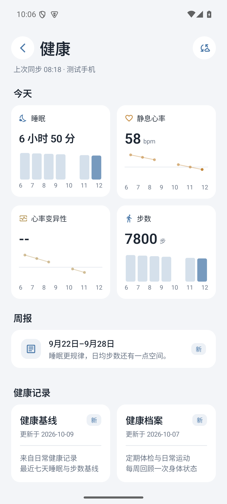</a><br><sub>健康页 · 演示数据</sub></td>
  </tr>
</table>

内置的 **10 个云端连接器**：QQ 邮箱、163 邮箱、126 邮箱、Gmail、腾讯企业邮、阿里企业邮、通用 IMAP、Tavily、微信读书、Wind AI。邮箱支持同一服务连接多个账号，授权参数在 App「连接应用」里填写。详见[连接器规格](spec/connectors.md)。

## 截图

### Mac：同一个豆豆，更大的屏幕

<p align="center"><a href="docs/images/mac-showcase.png">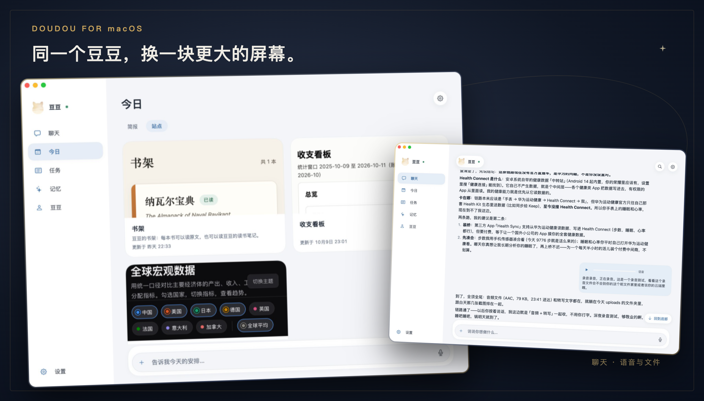</a></p>

桌面上看简报、用站点、传文件，菜单栏里随手聊两句。豆豆浏览器保留自己的登录状态，你也可以随时接手。手机和 Mac 共享同一个云端会话。

### 三套皮肤，三种日常

<p align="center"><a href="docs/images/skins.png">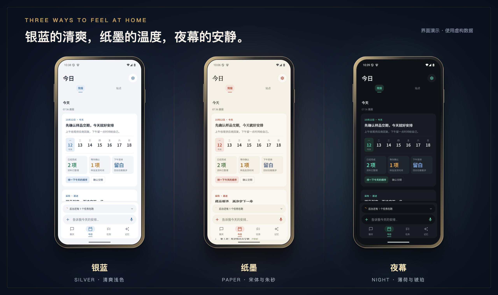</a></p>

**银蓝**清爽，**纸墨**用宋体和朱砂，**夜幕**用薄荷与琥珀。每台设备各自保存选择，聊天和简报一起换。上面的手机、Mac 截图来自脱敏真机；皮肤与健康页使用模拟器演示数据。

## 架构

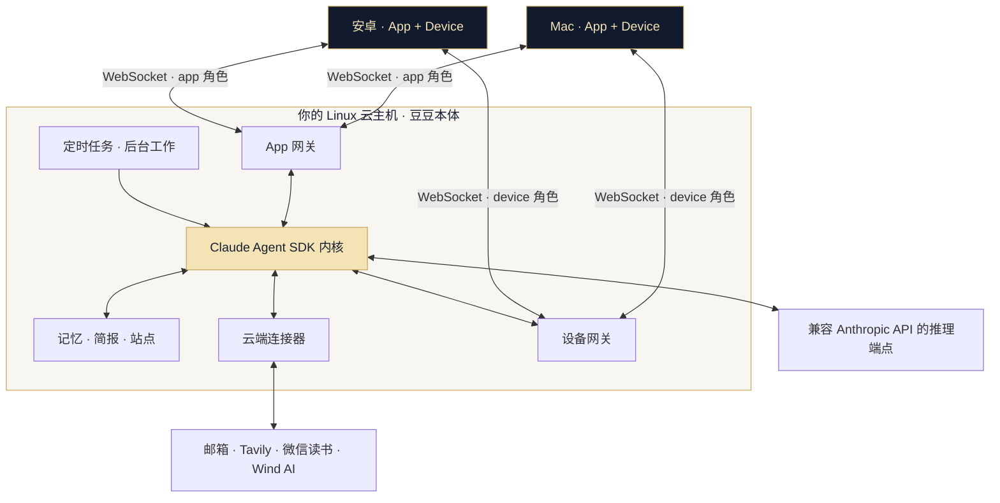

**云端是本体，手机和电脑是手脚。** App 角色负责消息、进度和内容展示，Device 角色负责已授权的本机能力，两者分别通过 WebSocket 接入。App 关掉后，云端仍能到点做事；设备调用需要那台设备在线。

个人内容保存在云主机的 `data/`，任务草稿在 `workspace/`，配置与运行状态在 `system/`。推理时会把本轮需要的对话、记忆和工具结果发给你配置的模型端点。详见[部署与数据目录](docs/deployment.md)。

## Spec

**`spec/` 是产品规格和系统提示词的唯一来源。** 页面行为、云端与设备的分工、记忆规则、晨晚报和简报写法，都在这里对齐。

<p align="center"><a href="docs/images/spec-overview.png">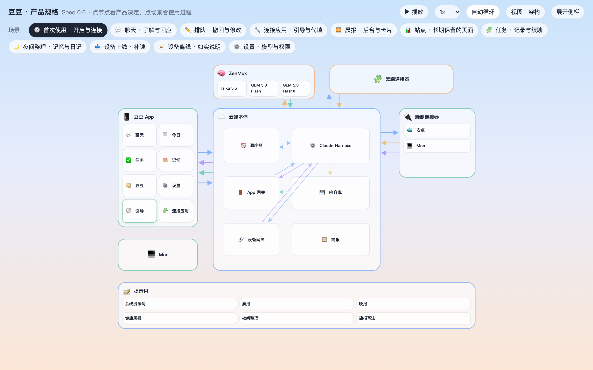</a></p>

<table width="100%">
  <tr>
    <td width="50%" align="center"><a href="docs/images/spec-today.png">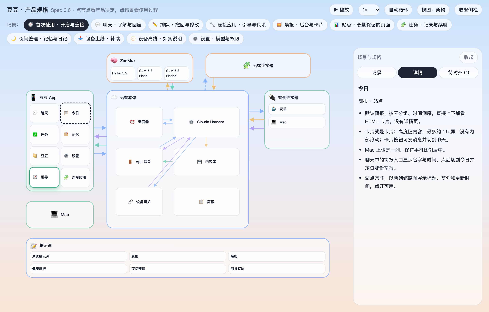</a><br><sub>点节点，看用户会看到什么</sub></td>
    <td width="50%" align="center"><a href="docs/images/spec-prompts.png">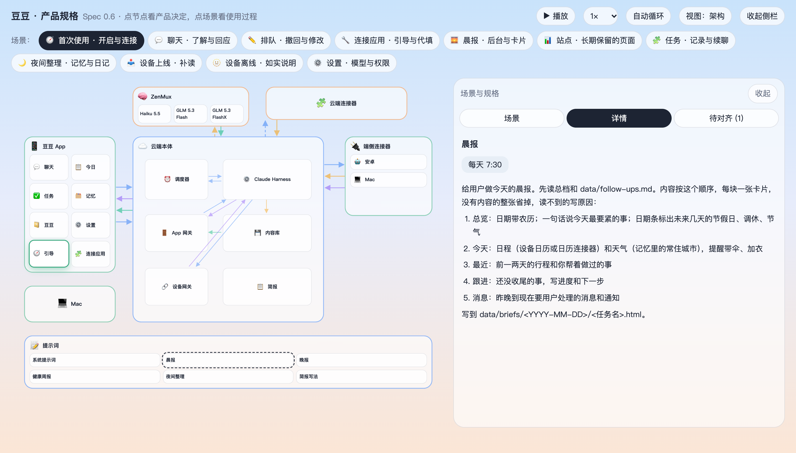</a><br><sub>点提示词，读触发条件与全文</sub></td>
  </tr>
</table>

克隆后，用浏览器直接打开 [`spec/index.html`](spec/index.html)，无需启动服务。点场景播放流程，切换「架构 / 边界」看数据流向，点节点展开规格。它是离线产品演示。

```bash
# 在仓库根目录；macOS 可直接打开
open spec/index.html

# 修改 spec.yaml 或提示词后，重新生成离线页面
node spec/build.mjs
```

规格数据在 [`spec/spec.yaml`](spec/spec.yaml)，系统提示词和简报写法在 [`spec/prompts/`](spec/prompts/)。

## 部署

### 让豆豆住进自己的云主机

准备一台 **Linux 服务器**，安装 **Node.js ≥ 20.9、Git、curl、OpenSSL、Nginx**，具备 `sudo` 与 `systemd`，并为自己的域名配置 HTTPS。服务模板使用 `/usr/bin/node` 和 `/opt/personal-agent`。还需要一个兼容 Anthropic API 的推理端点与访问凭据；该端点须支持 App 中的模型 ID，或提供相应映射。

```bash
sudo git clone https://github.com/Xiamu-ssr/personal-agent.git /opt/personal-agent
sudo touch /etc/personal-agent.env
sudo chmod 600 /etc/personal-agent.env
sudoedit /etc/personal-agent.env
```

在环境文件里填写自己的配置：

```dotenv
ANTHROPIC_BASE_URL=https://api.example.com/anthropic
ANTHROPIC_AUTH_TOKEN=replace-with-your-api-key
AGENT_TZ=Asia/Shanghai
```

在已经配置好证书的 Nginx HTTPS `server` 块中加入：

```nginx
include /etc/nginx/agent-location.inc;
```

然后安装服务。脚本会安装云端依赖、创建 `agent` 用户与 `/srv/agent`、生成 `AGENT_TOKEN`，安装 systemd 服务和 Nginx `/agent/` 路由，并重启服务、重载 Nginx。

```bash
cd /opt/personal-agent/cloud
sudo bash deploy/install.sh

# 确认自己的服务和 HTTPS 路由可达
curl --fail https://agent.example.com/agent/health

# 为一台 App 生成一次性配对码
sudo -u agent /usr/bin/node /opt/personal-agent/cloud/src/pair.mjs
```

从 [Releases](https://github.com/Xiamu-ssr/personal-agent/releases/latest) 下载 **Android APK** 或 **Mac DMG**。第一次登录，填写**自己的云端地址**（例如 `https://agent.example.com/agent`）和刚生成的六位配对码。配对码 24 小时有效、用后作废；配另一台设备时重新生成。

登录后先发一条消息，确认模型确实能回复，再在「连接应用」开启需要的本机能力与云端服务。`/health` 成功只说明服务可达。浏览器截图、语音转写的准备方式见[完整部署指南](docs/deployment.md)。

<details>
<summary><strong>环境变量一览</strong></summary>

| 变量 | 默认值 / 用途 |
| --- | --- |
| `ANTHROPIC_BASE_URL` | 必填；自己的 Anthropic 兼容 API 基址 |
| `ANTHROPIC_AUTH_TOKEN` | 必填；自己的模型端点访问凭据 |
| `AGENT_TOKEN` | 必需；`install.sh` 在环境文件中没有该项时自动生成，用于 App / 设备鉴权 |
| `AGENT_ROOT` | `/srv/agent`；个人内容与运行状态的根目录 |
| `AGENT_HOST` | `127.0.0.1`；默认由 Nginx 对外提供 HTTPS |
| `AGENT_PORT` | `4400`；改动时同步修改 Nginx 上游 |
| `AGENT_TZ` | `Asia/Shanghai`；时间与定时任务的时区 |
| `AGENT_NAME` | `豆豆`；助手名字 |
| `AGENT_USER_CALL` | `用户`；对你的称呼 |
| `AGENT_COMPACT_EFFORT` | `low`；上下文压缩强度，可选 `low` / `medium` / `high` |
| `AGENT_SCREENSHOT_BROWSER` | 可选；Chrome / Chromium 可执行文件路径，用于简报、站点截图检查 |
| `AGENT_ASR_MODEL` | `google/gemini-3.5-flash-lite`；语音转写所用的音频模型 |
| `HTTPS_PROXY` | 可选；按服务器自己的出站网络环境填写 |

模型和权限模式在 App 设置里选择。当前支持的模型 ID 见 [`cloud/src/app-settings.mjs`](cloud/src/app-settings.mjs)。更改 `AGENT_ROOT` 时，还需同步调整服务工作目录、目录权限和配对命令；完整说明见[部署指南](docs/deployment.md)。

</details>

### 从源码构建

**安卓**：JDK 17、Android SDK 36；最低 Android 9。以下命令从仓库根目录开始：

```bash
cd android
./gradlew assembleRelease
# 产物：app/build/outputs/apk/release/app-release.apk
```

自己的发布签名可配置在 `~/.personal-agent/signing.properties`，字段为 `storeFile`、`storePassword`、`keyAlias`、`keyPassword`。没有该文件时，当前构建脚本使用 debug 签名。

**Mac**：macOS 14+、Xcode Command Line Tools。以下命令也从仓库根目录开始：

```bash
# 首次构建，创建自己的本地签名身份（可能弹出钥匙串授权）
bash mac/tools/make-signing-identity.sh
VERSION=0.6.0 bash mac/build.sh
# 产物：mac/build/doudou-0.6.0.dmg；Apple 芯片 + Intel 通用
```

Mac 安装包采用本地签名；另一台 Mac 首次打开可能需要右键「打开」。健康数据是否可读取决于 Health Connect 与厂商开放情况；Wind 真实账号查询、Mac 真实触控板手势和新功能完整真机流程的验证边界，见 [v0.6.0 发布说明](https://github.com/Xiamu-ssr/personal-agent/releases/tag/v0.6.0)。

<details>
<summary><strong>更多截图 · v0.6.0 页面验收</strong></summary>

以下截图来自仓库的模拟器验收，使用虚构数据。点图可查看原图。

<table>
  <tr>
    <td align="center"><a href="android/verification/v0.6.0/tasks-grouped.png">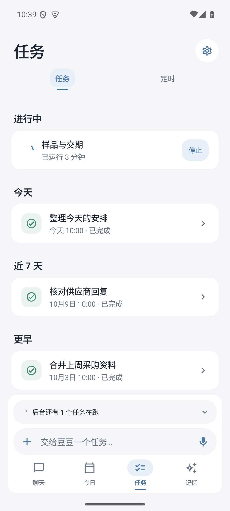</a><br><sub>任务分组</sub></td>
    <td align="center"><a href="android/verification/v0.6.0/task-detail.png">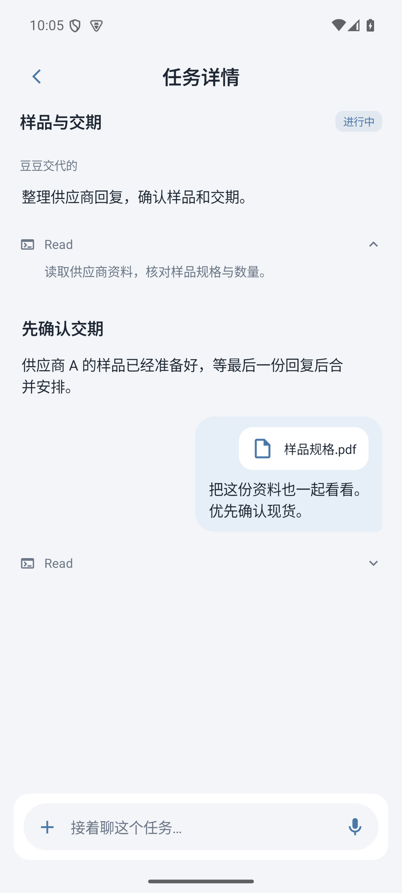</a><br><sub>任务续聊</sub></td>
    <td align="center"><a href="android/verification/v0.6.0/health-weekly.png">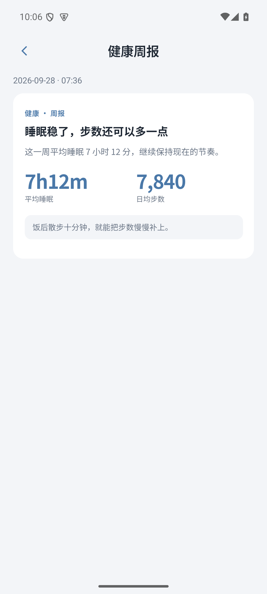</a><br><sub>健康周报</sub></td>
  </tr>
  <tr>
    <td align="center"><a href="android/verification/v0.6.0/chat-silver.png">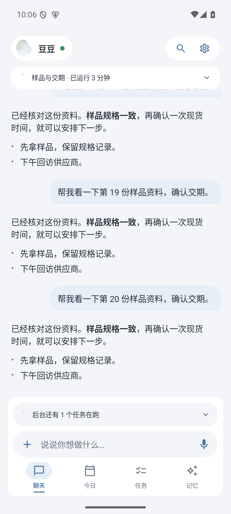</a><br><sub>银蓝 · 聊天</sub></td>
    <td align="center"><a href="android/verification/v0.6.0/chat-paper.png">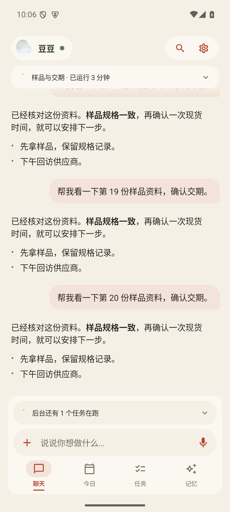</a><br><sub>纸墨 · 聊天</sub></td>
    <td align="center"><a href="android/verification/v0.6.0/chat-night.png">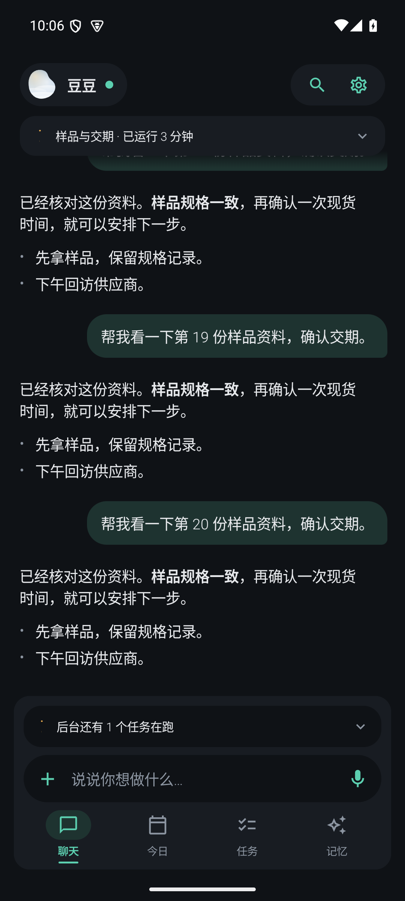</a><br><sub>夜幕 · 聊天</sub></td>
  </tr>
</table>

[安卓验证目录](android/verification/v0.6.0/)

</details>

## License 与致谢

以 [MIT License](LICENSE) 开源，Copyright © 2026 Xiamu-ssr。第三方依赖与素材遵循各自许可证。

感谢 [Claude Agent SDK](https://github.com/anthropics/claude-agent-sdk-typescript)、[Model Context Protocol](https://github.com/modelcontextprotocol/typescript-sdk)、[Jetpack Compose](https://developer.android.com/compose)、[SwiftUI](https://developer.apple.com/xcode/swiftui/)、[Playwright](https://github.com/microsoft/playwright)、[shields.io](https://shields.io/) 与所有依赖项目。简报的信息层次受到 Today AI 启发。

<p align="center"><strong>如果你也想拥有一个一直在身边的私人助手，给豆豆一颗 Star。</strong><br><sub>从自己的云主机开始，让它慢慢认识你。</sub></p>
