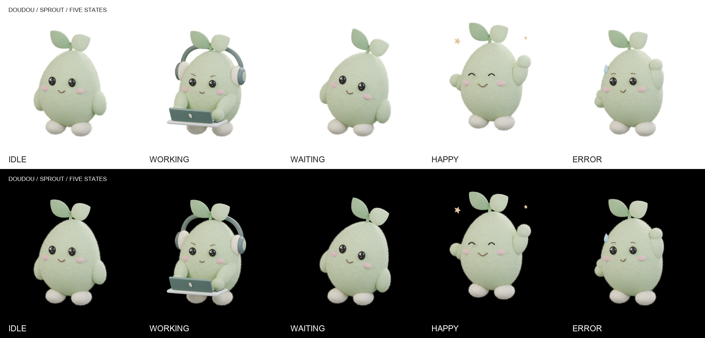

# 豆豆 0.8 · 芽豆

已选定 **A · 芽豆**：开心果绿色的圆润豆种，头顶两片软叶，柔软的短绒表面与简单的五官在聊天顶部的小尺寸下仍易于辨认。全部模型、材质、灯光、道具及动画由 Python 在本机 Blender 中生成，无下载模型或贴图。

## 五种状态



| 状态 | 动作 | 文件 |
| --- | --- | --- |
| `idle` 空闲 | 看着你，轻轻呼吸，一次眨眼，双叶轻晃。 | [透明静帧](states/idle/still.png) · [白底视频](states/idle/light.mp4) · [黑底视频](states/idle/dark.mp4) · [四帧检查](states/idle/frames.png) |
| `working` 工作中 | 戴小耳机，在小笔记本电脑上交替敲键盘，轻轻前倾。 | [透明静帧](states/working/still.png) · [白底视频](states/working/light.mp4) · [黑底视频](states/working/dark.mp4) · [四帧检查](states/working/frames.png) |
| `waiting` 等你回复 | 歪头看着你，缓缓轻晃、眨眼。 | [透明静帧](states/waiting/still.png) · [白底视频](states/waiting/light.mp4) · [黑底视频](states/waiting/dark.mp4) · [四帧检查](states/waiting/frames.png) |
| `happy` 完成 | 笑眼、挥手、小跳一下，两颗小星星轻轻闪现。 | [透明静帧](states/happy/still.png) · [白底视频](states/happy/light.mp4) · [黑底视频](states/happy/dark.mp4) · [四帧检查](states/happy/frames.png) |
| `error` 出错 | 挠挠头，流一滴汗，保持温和、有点不好意思的表情。 | [透明静帧](states/error/still.png) · [白底视频](states/error/light.mp4) · [黑底视频](states/error/dark.mp4) · [四帧检查](states/error/frames.png) |

每个状态目录只有上述四个文件：

- `still.png`：1024×1024，RGBA 透明背景，选取该状态的代表姿势。
- `light.mp4` / `dark.mp4`：512×512，24fps，60 帧，2.5 秒；H.264 / yuv420p / BT.709，无音轨，faststart；分别在 `#FFFFFF` / `#000000` 上合成后编码。
- `frames.png`：从两段最终 MP4 各抽取四帧，排成白底、黑底两行；尺寸 1024×566。空闲 / 等待选帧包含眨眼，工作选帧避开打字动作的同相位；每帧标有实际时间，具体帧号记录在 manifest。

五种状态共用同一台正交相机、四盏棚拍面光、世界光、身体中轴和脚底基准。歪头、呼吸、小跳是姿势动作；画布、镜头及渲染尺度不变，头顶和脚底保留空间。画面不使用地面、环境背景图或暗角。

## 循环与纯色背景

动作由周期函数和在两端归零的平滑动作窗口生成。眨眼、汗滴、小跳和星星避开循环接点；呼吸、叶片和手臂在接点处减速。程序会检查完整控制层级在 `t=0`、`t=1` 的矩阵与显隐状态一致。

第 60 帧使用第一帧的同一份透明 PNG。编码使用固定量化 `QP=18`、相同的 I 帧量化、关闭 B 帧，并将第一帧和最后一帧设为独立 I 帧，使解码后的 RGB 首尾帧也一致。其余帧保留帧间压缩，控制文件体积。

白底和黑底使用同一批透明帧合成。显式使用 BT.709 与 limited-range YUV 转换和标记，再检查解码 RGB；不会把场景光照或材质的渐变当作背景。验证逐段检查所有帧的四角和完整 12px 外边框，像素必须分别等于 `(255,255,255)` 和 `(0,0,0)`。

## 重新生成

在仓库根目录执行，使用已有 Blender、Python 3 + Pillow、ffmpeg，不会安装软件或访问网络：

```sh
python3 -B design/mascot/scripts/generate_states.py
```

默认 Blender 为 `/Applications/Blender.app/Contents/MacOS/Blender`；自动使用可用的 Metal GPU，也可传入 `--cpu`。ffmpeg 由 `PATH` 查找；可用 `--blender /path/to/Blender --ffmpeg /path/to/ffmpeg` 指定现有可执行文件。

```sh
# 五张代表静帧
python3 -B design/mascot/scripts/generate_states.py --mode still

# 十段黑白视频，以及从成品视频抽帧的检查图
python3 -B design/mascot/scripts/generate_states.py --mode animation

# 仅重做一个状态
python3 -B design/mascot/scripts/generate_states.py --state working

# 从已有视频重建四帧检查图，并重建总览
python3 -B design/mascot/scripts/generate_states.py --mode compose
```

渲染中间文件、透明帧、日志和抽帧默认存放 `/tmp/v08-mascot/states-final/`，可用 `--work` 修改。静帧默认 96 samples，动画 32 samples；参数为 `--still-samples` / `--video-samples`。仓库只保存脚本、说明和最终成品。

单独使用 Blender 试渲染一个姿势，`--phase` 为 0–1 的循环位置：

```sh
/Applications/Blender.app/Contents/MacOS/Blender -b --factory-startup --python-exit-code 1 \
  -P design/mascot/scripts/state_scene.py -- \
  --state error --mode still --resolution 640 --samples 32 --phase 0.43 \
  --output /tmp/v08-mascot/custom/error.png
```

`scene.py` 保留第一阶段程序化建模与材质；`state_scene.py` 增加姿势控制、表情、耳机、电脑和周期动作；`generate_states.py` 负责批量渲染、严格背景合成、编码、总览及抽帧。短绒由确定性表面积采样的锥形微纤维网格和噪声法线构成，无毛发模拟或外部纹理。随机种子 `80415`。不同 Blender / 设备不保证重渲染逐像素一致。

## 验证与记录

```sh
python3 -B design/mascot/scripts/verify_states.py
```

该命令实际执行 ffprobe 和完整 ffmpeg 解码，检查十段视频的尺寸、帧率、时长、编码、像素格式、无音轨、文件大小、首尾帧差异及所有帧的四角 / 外边框。还检查五张静帧的真实透明与完整轮廓、五种状态的镜头灯光一致，以及成品哈希。

- [`states/manifest.json`](states/manifest.json)：渲染参数、镜头灯光、耗时、文件大小与 SHA-256。
- [`states/verification.json`](states/verification.json)：每段视频的首尾 RGB MAE、最大通道差、变化像素数、邻接帧差、四角 RGB 与外边框误差；MAE 使用 0–255 的 RGB 码值。
- 解码检查用中间图默认位于 `/tmp/v08-mascot/states-qa/`。

### 本次实测

Blender 5.2.1 LTS / Cycles / Apple M4 10 核 GPU；静帧 96 samples、动画 32 samples。五张静帧与五组透明动画的渲染合计 **285.546 秒（约 4 分 46 秒）**；两种背景合成与视频编码另计 **6.643 秒**。

| 状态 | 白底视频字节数 | 黑底视频字节数 | 首尾 RGB MAE：白 / 黑 |
| --- | ---: | ---: | ---: |
| `idle` | 138,700 | 175,240 | 0 / 0 |
| `working` | 140,950 | 168,748 | 0 / 0 |
| `waiting` | 184,496 | 223,237 | 0 / 0 |
| `happy` | 238,218 | 291,434 | 0 / 0 |
| `error` | 182,415 | 223,670 | 0 / 0 |

十段视频均通过 ffprobe 格式检查及完整解码，共 **600 帧**。解码后首尾帧的最大通道差、变化像素数也全部为 **0**。逐视频中间帧的左上 / 右上 / 左下 / 右下四角：白底均为 `(255,255,255)`，黑底均为 `(0,0,0)`；所有 600 帧的四角及完整 12px 外边框最大通道误差为 **0**。最大单段 291,434 字节，均低于 1MB。

五张透明静帧的完整轮廓、所有状态镜头与灯光一致、成品哈希检查均通过。已目检总览、各状态四时刻检查图及 120px 缩小后的辨识度。本次正式生成和验收没有剩余失败。

当前交付为本地媒体资源；尚未接入 Android / Mac App，也未做真实播放器切换与设备验收。

## 第一阶段归档

保留 [A · 芽豆原始候选](candidates/a/portrait.png)、[A 的转台](candidates/a/turntable-white.mp4)、[三候选黑白对比图](candidates/compare.png) 和 [120px 对比图](candidates/compare-120.png)。未选中的 `candidates/b/`、`candidates/c/` 已按要求删除。历史 manifest 中的 B/C 哈希与耗时仅记录第一阶段，已注明输出移除。

如需重新生成已选 A 的原始候选：

```sh
python3 -B design/mascot/scripts/generate.py --candidate a
python3 -B design/mascot/scripts/verify.py
```

候选生成脚本默认只生成 A；保留 B/C 的程序化构造代码用于设计历史，只有显式选择它们才会重建其目录。原始三候选对比图在缺少 B/C 输出时不会被覆盖。
