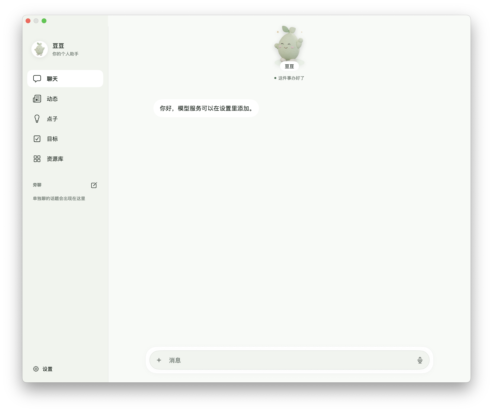
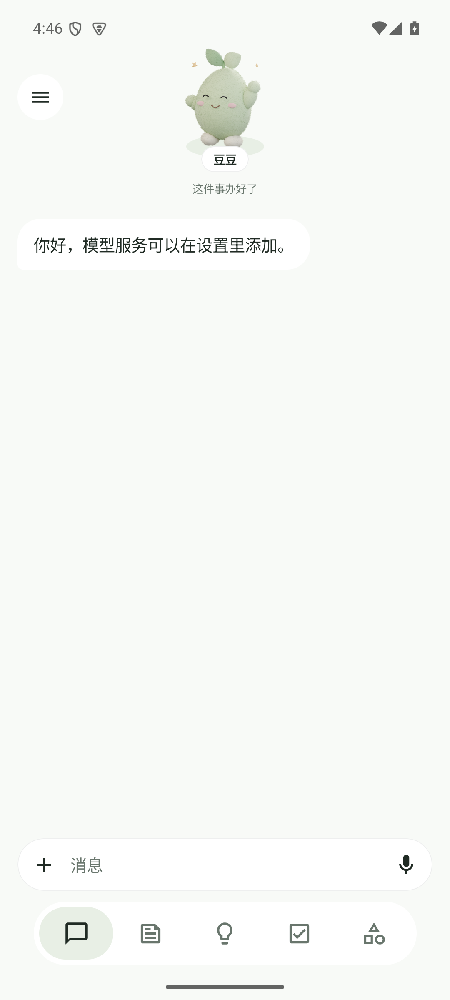
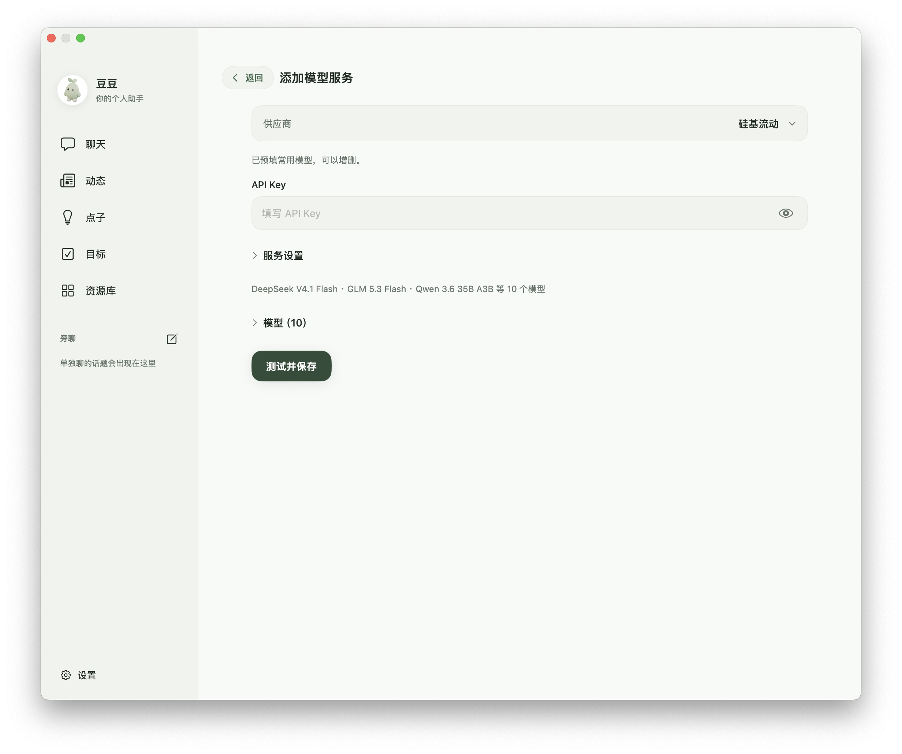
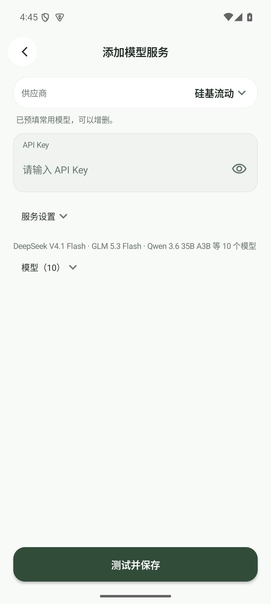
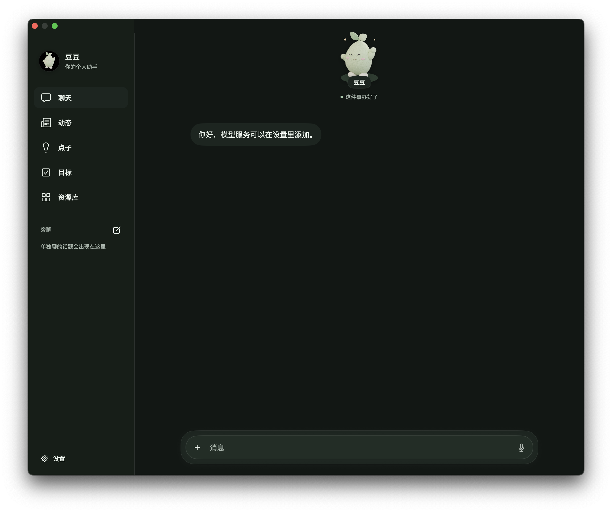

# 1.2 界面

实际原生界面截图，使用隔离数据与本机假服务；不含生产账号、密钥或私人对话。Mac 为原生窗口，Android 为 API 35 模拟器。

两端共享功能与内容，按屏幕和系统授权适配。统一柔和底色、主次按钮、表单焦点和卡片；完成与等待时，芽豆短暂探出圆形底座。保留原有五组 3D 视频，本次探出效果复用透明静帧与界面动画；减少动态效果时保持静态。

| Mac | Android |
| --- | --- |
|  |  |
|  |  |
|  |  |
