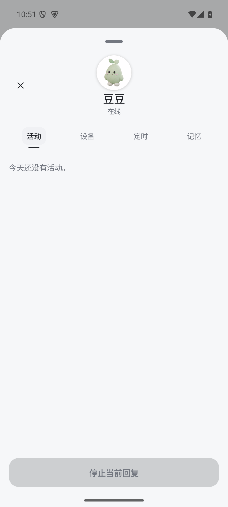
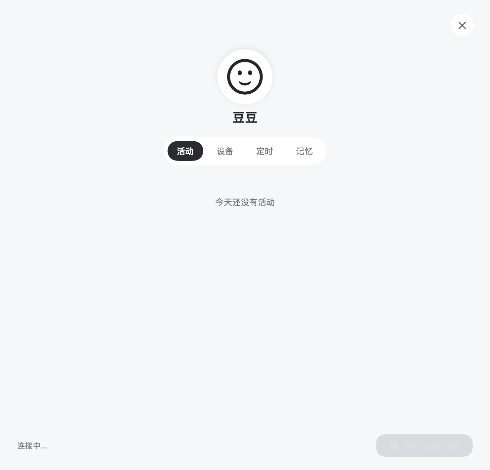
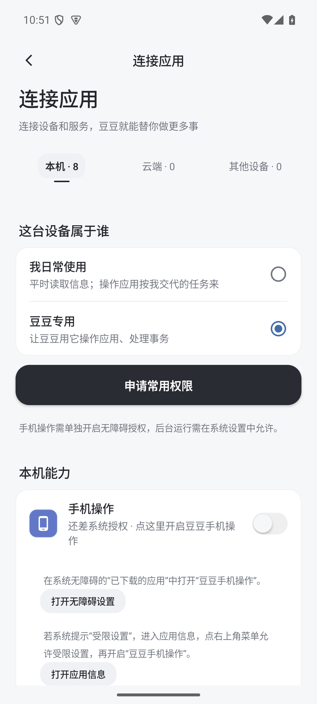
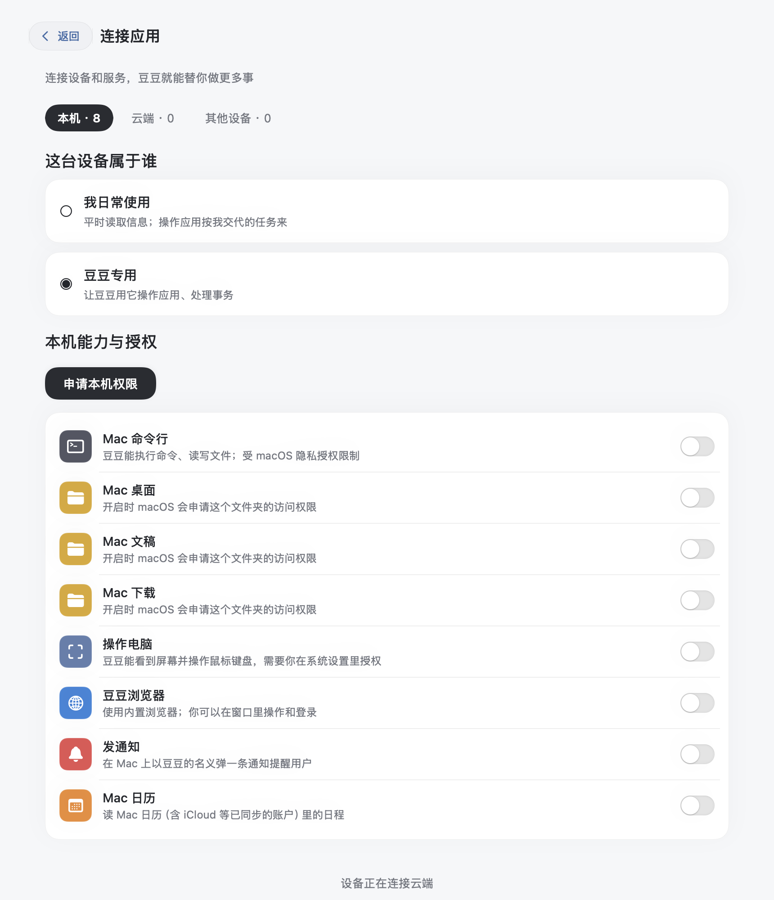

# 豆豆 1.5.0 验收

设备归属和授权统一到「连接应用 → 本机」。Android、Mac 的头像控制台只保留活动、设备、定时、记忆；重复页面和路由直接删除，聊天中的授权卡片也进入本机连接器。

Android Phone Use 的滚动与滑动使用小幅曲线、距离自适应时长和先加速后减速的连续触摸。起止点不随机偏移。中断时完成当前短段并松手，再释放操作队列，防止旧动作的回调干扰下一动作。

## 验证

| 范围 | 结果 |
| --- | --- |
| Android 单元检查 | 166 项通过，包括边界、短距离、落点、时长与曲线变化 |
| Android 系统触摸 | Android 15 虚拟机实际运行 AccessibilityService；上下、左右、斜向滑动均为一次 DOWN/UP，五次落点误差均为 0 像素；节点区域滚动、中断松手、立即执行下一动作通过 |
| Android 界面 | 合成账号进入头像控制台和本机连接器；四个栏目、归属和授权控件正常 |
| Mac | 223 项核心断言、附件布局及登录地址检查通过；原生 SwiftUI 界面和设备归属持久化通过 |
| 安装包 | APK 签名与已安装正式版一致，签名正式包已在虚拟机升级安装成功；DMG 校验、应用签名、arm64/x86_64 架构及隔离启动通过；APK 不含验收 Activity 和测试写健康数据权限 |
| Spec | 重新生成，构建通过 |

本轮 OPPO 因锁屏且用户暂时无法解锁，未完成真机操作和升级验收。虚拟机结果不代表本轮 OPPO 实测。原手机的授权、配对和显示设置已保留/恢复。

Mac 使用现有本地签名，未做 Apple 公证。首次打开被系统拦截时，可在「系统设置 → 隐私与安全性」核对应用后选择「仍要打开」。

此版只有客户端变化，云端沿用 1.4.0；协议、设备身份和持久化格式均未变，无需停服或迁移数据。

完整结果：[results.json](results.json)；系统触摸测量：[android-touch.json](android-touch.json)。所有截图和触摸数据来自隔离的合成环境，不含真实聊天、账号、服务器或密钥。

| Android | Mac |
| --- | --- |
|  |  |
|  |  |

## 复现

```sh
cd android
./gradlew :app:testDebugUnitTest :app:assembleDebug :app:assembleDebugAndroidTest
# 在隔离的 Android 15 虚拟机安装两个 Debug APK 后执行：
adb -s emulator-5566 shell am instrument -w -r \
  -e class com.xiamu.agent.device.TouchMotionDeviceTest \
  com.xiamu.agent.checks.test/androidx.test.runner.AndroidJUnitRunner
```

界面使用合成云端夹具；触摸测试不调用模型或访问其他应用。Mac 原生审阅入口为 `mac/Tests/V15Review.swift`，需设置独立 `DOUDOU_DATA_DIR` 和显式回环服务器。
