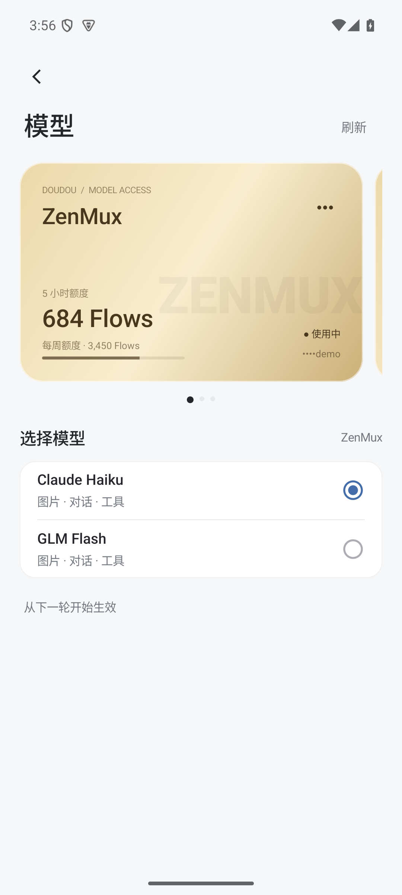
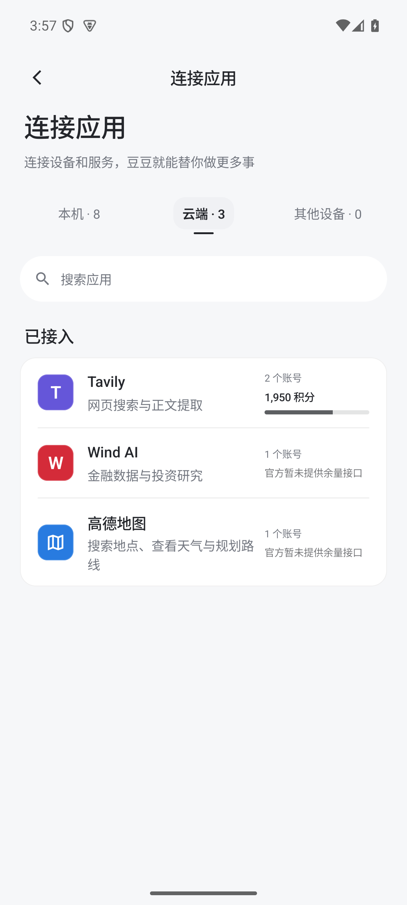
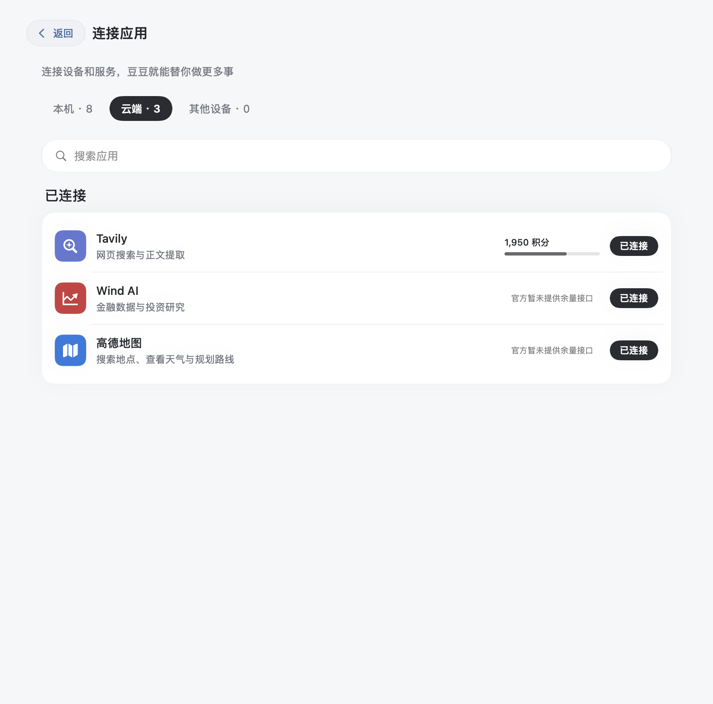
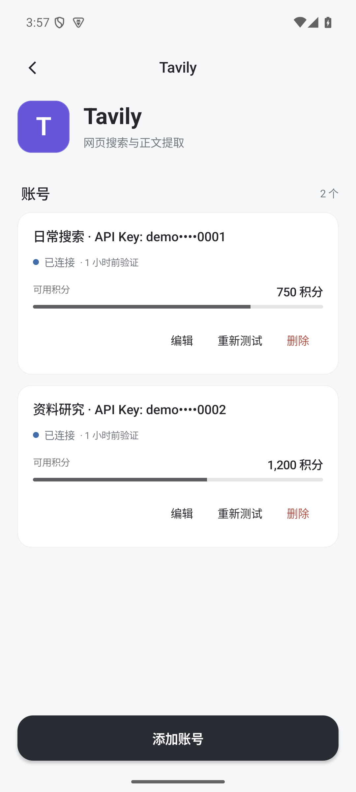
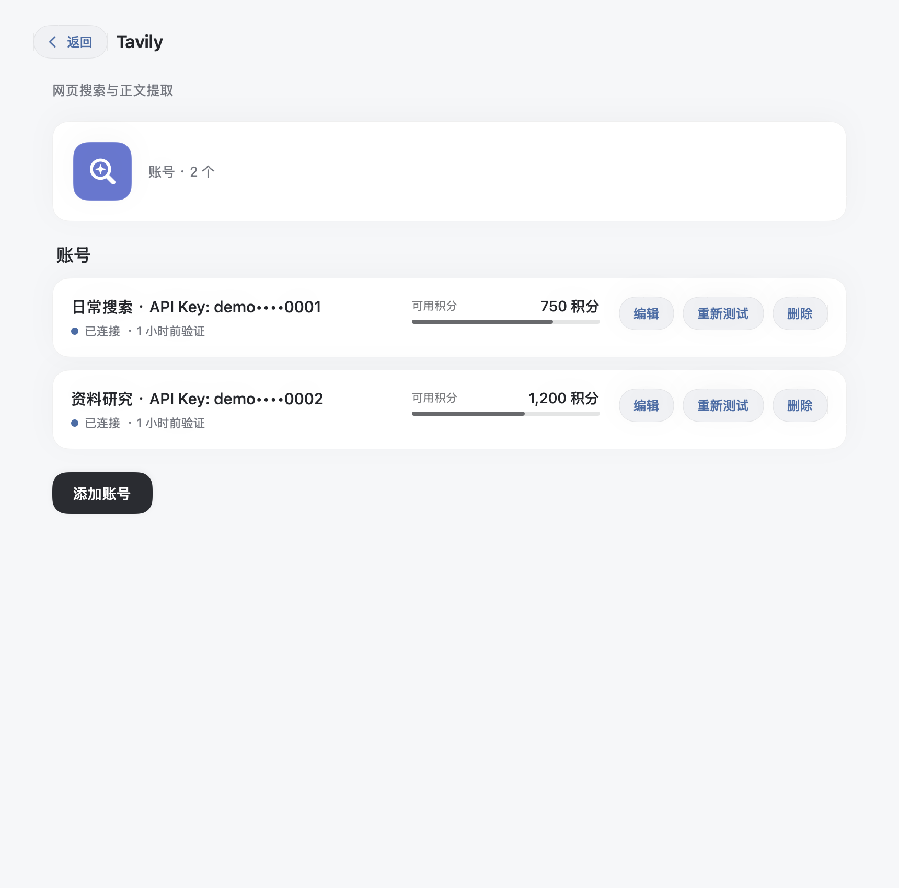

# 豆豆 1.6.0 验收

模型设置改为横滑金色卡片：供应商名称水印、额度或余额、编辑入口、模型选择，以及最后的新增空卡片。新增服务直接选中；删除当前服务时切换到其他已配置账号，保留最后一个可用服务。

连接器列表显示总余量进度，详情按账号展示。Tavily 查询官方真实积分；Wind、高德目前没有已确认的公开精确余额接口，明确显示未提供查询。Wind 已知耗尽独立标注。未知值不转成零，不生成假百分比；部分失败标注已查询账号数。同一账户的多个 Tavily Key 共享额度，不能作为多个独立账号累计。

模型余额支持 DeepSeek、ZenMux 管理 Key，以及 OpenRouter 当前 Key 的预算。其他供应商保留明确的未接入状态。服务端统一查询和缓存，密钥不交给 App 或模型。

## 实施文件

- 云端：`cloud/src/usage.mjs`、`providers.mjs`、`server.mjs`、`connectors.mjs`；模型读取、OpenClaw 配置和语音转写改用普通供应商账号。
- Android：`Usage.kt`、`ui/UsageView.kt`、`ui/ModelSettings.kt`、`ui/ProviderForm.kt` 与连接器列表、详情和数据模型。
- Mac：`Sources/Usage.swift`、`ModelProviders.swift`、`Connectors.swift`。
- Spec、部署和模型服务说明同步更新；新增查询、迁移、删除和原生界面验收。
- 发布同时保留已经在云端部署的 HTTPS 代理证书校验修复，独立提交，不覆盖现有传输行为。
- 主聊天删除产品层串行队列，改用 OpenClaw `chat.send` 的原生 steer；忙碌时的补充显示在同一活动中。动态工具以 `args_json` 传参，校验错误同步到活动，原生重复调用检测开启。

## 验证

| 范围 | 结果 |
| --- | --- |
| Cloud | 139 项通过；余量加权汇总、部分失败、并发缓存、换 Key、秘密隔离、供应商迁移与活动账号删除；忙碌消息、结束边界竞态与动态工具参数回归 |
| OpenClaw | 真实内核配本地模型夹具，记忆检索、工具往返、同一主 Session、重启续接和停止通过；工具运行期间接收两条补充，下一次模型调用看到两条输入；272K 主动压缩后 Session ID 保持 |
| Android | 168 项单元检查通过；Android 15 虚拟机完成 7 项原生交互检查，含横滑、编辑、删除、新增、管理 Key 和多账号余量 |
| Mac | 223 项核心断言、附件布局与登录地址检查通过；实际 SwiftUI 按钮切换模型和供应商、余额、末尾新增卡片、多账号详情通过 |
| 安装包 | 正式签名 APK 升级安装为 versionCode 23 / 1.6.0；DMG 含 arm64、x86_64，签名与磁盘镜像校验通过 |
| 隐私 | 界面截图和 HTTP 验收仅使用合成账号与回环服务，不包含真实凭据、服务器或聊天 |

Mac 沿用现有本地签名，未做 Apple 公证。本轮未使用 OPPO 真机，虚拟机与本地模型夹具不代表真实设备、外部模型或供应商账单实测。Android 验收完成后关闭模拟器与本地夹具，保留实体设备连接。

## 升级

先等运行中的工作结束，停服并完整备份数据和环境配置。原内置 ZenMux 自动导入私有 `system/providers.json` version 2，保留原 ID、当前模型、其他账号、记忆、连接器和原生 Session。后续编辑、删除以该文件为准，不会因重启重新出现。

## 界面

| Android | Mac |
| --- | --- |
|  |  |
|  |  |
|  |  |

## 复现

`cloud/test/usage.test.mjs` 测试官方响应投影及账号生命周期。`cloud/test/usage-ui-fixture.mjs` 启动回环夹具后，使用独立 Android 15 虚拟机运行 `android/tools/review-v16.py`；脚本拒绝实体设备。Mac 使用独立 `DOUDOU_DATA_DIR` 编译运行 `mac/Tests/V16Review.swift`。截图中的余额均为明确的合成数据。

`node cloud/scripts/verify-main-steering.mjs`（在 cloud 目录中运行时去掉路径前缀）使用真实内核、阻塞的合成工具和本地模型验证忙碌时收消息，不依赖外部搜索额度。
